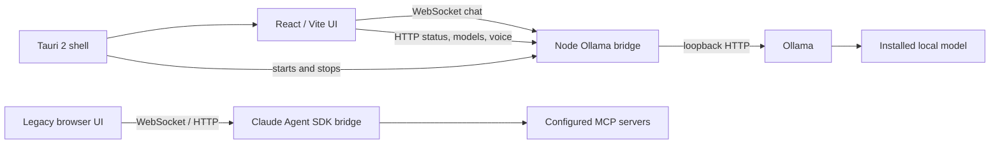

# J.A.R.V.I.S.

J.A.R.V.I.S. is a local-first AI assistant project with a holographic React interface, a local Ollama bridge, and an in-progress Tauri 2 desktop shell. A separate legacy browser experience and Claude Agent SDK bridge remain in the repository.

The source tree contains both the established browser interface and newer desktop/Ollama work. The Tauri package configuration targets AppImage and Debian packages, but a successful native package build has not yet been verified on this checkout.

## Features in the current source

- React 19 and TypeScript interface built with Vite.
- Three.js, React Three Fiber, and custom GLSL effects in the legacy holographic interface.
- Desktop shell with a central animated reactor, local model controls, chat history in WebView local storage, file attachment, screenshot capture, and read-only project excerpts.
- Local Node.js bridge for Ollama model discovery, heuristic role routing, streamed chat, model lifecycle operations, system metrics, and optional local speech tools.
- Optional local Whisper.cpp transcription and Piper speech when their programs and model files are configured.
- Preserved Claude Agent SDK bridge with MCP integration and a default-deny gate for effectful tools.

See [docs/PROJECT_OVERVIEW.md](docs/PROJECT_OVERVIEW.md) for the distinction between implemented, partial, and planned work.

## Screenshots

Screenshots are not included in this repository yet. Add reviewed images under `docs/assets/` and link them here when available.

<!-- Screenshot placeholder: docs/assets/jarvis-desktop.png -->

## Architecture



The desktop build defaults to the local Ollama provider. The older browser path uses the Claude bridge when selected; the optional direct Anthropic mode sends its API key to the browser bundle and should only be used for a local demo. Details are in [docs/ARCHITECTURE.md](docs/ARCHITECTURE.md) and [docs/AI_INTEGRATION.md](docs/AI_INTEGRATION.md).

## Technology

React, TypeScript, Vite, Three.js, React Three Fiber, GLSL, Zustand, Node.js, WebSocket (`ws`), Ollama, and a Tauri 2 Rust shell. The complete dependency inventory is in [docs/TECH_STACK.md](docs/TECH_STACK.md).

## Prerequisites

- Node.js 20 or newer and npm.
- Ollama, running locally, with a chat-capable model already installed. The bridge does not download models on startup.
- For the native desktop build: Rust/Cargo, the Tauri CLI, and the Linux WebKitGTK build dependencies listed in [INSTALL-DESKTOP.md](INSTALL-DESKTOP.md).
- Optional local voice: `whisper-cli`, `ffmpeg`, and a local Whisper model for transcription; `piper` and a local voice model for speech output.

## Install and run

```bash
git clone <repository-url>
cd jarvis
npm install
npm run setup
```

For the native desktop window, install the documented Linux and Rust prerequisites, then the Tauri CLI if it is not already installed. Start with:

```bash
npm start
```

The launcher checks for Ollama and an installed Qwen model, then opens a built AppImage if present or a Tauri development window. The Tauri shell starts the Ollama bridge and stops the child process when the app exits.

For web development of the local Ollama interface, use two terminals:

```bash
# Terminal 1
npm run bridge:ollama

# Terminal 2
npm run dev
```

Then open the Vite URL shown in the terminal. For the preserved Claude browser experience, use the Claude bridge and its matching frontend configuration; see [docs/DEVELOPMENT_GUIDE.md](docs/DEVELOPMENT_GUIDE.md).

## Ollama model configuration

Check your installed tags with `ollama list`. The bridge prefers a Qwen 14B model, then another Qwen model, then the first installed model. To pin a tag, export `OLLAMA_MODEL` in the environment that starts the bridge, for example:

```bash
export OLLAMA_MODEL=qwen3:14b
npm run bridge:ollama
```

The model router uses prompt keywords and installed model names. It is a simple heuristic, not a trained classifier. The current chat request sets `num_ctx` to 4096 in code. Model capabilities and loaded state depend on the local Ollama installation. See [docs/AI_INTEGRATION.md](docs/AI_INTEGRATION.md).

## Configuration

Copy `.env.example` as a reference when configuring the frontend. Vite reads `VITE_*` variables from `.env.local`; keep that file private and untracked. The Node bridge reads its `OLLAMA_*`, `WHISPER_MODEL`, `PIPER_MODEL`, and `JARVIS_*` variables from its process environment; it does not load `.env.local` itself.

Never commit credentials. In particular, `VITE_ANTHROPIC_API_KEY` is bundled into client-side code in `direct` mode. Use the local Ollama provider for local inference. Full variable descriptions are in [docs/DEVELOPMENT_GUIDE.md](docs/DEVELOPMENT_GUIDE.md) and [docs/SECURITY.md](docs/SECURITY.md).

## Build, tests, and checks

```bash
npm run build
npm run lint
npm run test:local
npm run setup
```

Build AppImage and `.deb` packages with `npm run desktop:build` after Tauri, Rust, and system build dependencies are installed. The current tests cover Ollama model selection and routing; they do not constitute end-to-end desktop or live Ollama tests.

## Troubleshooting

- **Bridge offline:** make sure `npm run bridge:ollama` is running, or start the Tauri app so it owns the bridge lifecycle. Port `8787` must be available.
- **No model found:** start Ollama and install a model yourself; the bridge intentionally does not download one automatically.
- **Vision unavailable:** image requests require an installed compatible vision model such as a supported Qwen-VL or LLaVA tag.
- **Voice unavailable:** configure local Whisper/Piper tools and model paths. Text chat does not depend on them.
- **No GPU values:** `nvidia-smi` must work for GPU/VRAM telemetry. CPU and RAM values are collected separately.
- **Native build fails:** check Rust/Cargo, Tauri CLI, WebKitGTK, and other Linux dependencies in [INSTALL-DESKTOP.md](INSTALL-DESKTOP.md).

## Security notes

- The Ollama bridge binds to `127.0.0.1:8787`; keep it on loopback. Its model management endpoints can load, unload, download, and delete models.
- The Ollama chat path has no arbitrary shell execution tool. File and project inputs are explicitly selected by the user.
- The legacy Claude bridge can access MCP tools from Claude configuration. Effectful tools are denied by default; enabling `JARVIS_ALLOW_WRITES` changes that trust boundary.
- The optional direct Anthropic backend exposes its `VITE_ANTHROPIC_API_KEY` to the client. Do not use it with a shared or public deployment.
- The Tauri config currently sets `security.csp` to `null`; the browser `index.html` CSP does not by itself prove the packaged WebView has an equivalent policy.

See [docs/SECURITY.md](docs/SECURITY.md) before exposing services or enabling actions.

## Roadmap

The roadmap separates what exists from what remains partial or planned: [docs/ROADMAP.md](docs/ROADMAP.md).

## Contributing

Read [CONTRIBUTING.md](CONTRIBUTING.md) and [AGENTS.md](AGENTS.md) before making changes. Preserve existing work, run the relevant checks, and report any check that cannot run.

## License

The repository already contains an MIT `LICENSE`; this preparation retains it. Audio credits and the separate CC BY 4.0 notices are in [public/audio/CREDITS.md](public/audio/CREDITS.md).
