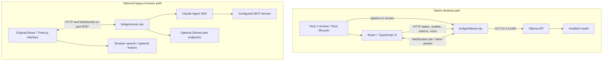

# Architecture

## Runtime overview

## Frontend

`src/main.tsx` selects `src/Desktop.tsx` by default. Setting `VITE_DESKTOP_SHELL=false` selects the older `src/App.tsx`. The old interface composes `src/scene/` and `src/ui/`, with state held in `src/store.ts`; Three.js, React Three Fiber, GLSL, and post-processing support the visual scene. The desktop shell has its own CSS, local chat state, model controls, and local service polling.

## Local AI bridge

`bridge/ollama.mjs` binds to `127.0.0.1` on port 8787 by default. It talks to Ollama at `127.0.0.1:11434` by default. HTTP handles health, model list/lifecycle, system metrics, and optional voice. The WebSocket handles chat turns and streams text deltas. The bridge sends chat requests to Ollama's `/api/chat` with `stream: true` and currently fixes `num_ctx` at 4096.

The router classifies by prompt keywords and looks for model names matching role patterns. It selects a primary model by configured tag, then a Qwen 14B, then any Qwen, then the first installed model. Missing specialist roles fall back to the primary model, except image attachments which require a vision-capable model.

## Tauri shell

`src-tauri/src/main.rs` checks whether port 8787 already serves the Ollama bridge. If so, it reuses it; if the port is occupied by another service, launch fails; otherwise it starts Node with the packaged bridge. The child bridge is stopped when the Tauri process exits. `tauri.conf.json` configures a frameless window and AppImage/`.deb` targets.

The current Tauri security config sets `app.security.csp` to `null`. Do not treat the browser CSP in `index.html` as proof that the packaged WebView has an equivalent policy.

## Legacy provider and communication

`src/lib/brain.ts` chooses between `ollama`, `bridge`, and `direct` backends. The `bridge` provider uses `src/lib/bridge.ts` and `bridge/server.mjs`; the server runs Claude Agent SDK queries and forwards MCP, UI, panel, and tool events over WebSocket. The direct provider is a browser-side Anthropic API integration.

## Data storage

The desktop shell stores conversation threads and a few preferences in WebView localStorage. The current project has no database schema, server-side conversation store, or document index. Project context is read from a user-selected folder and sent as bounded text excerpts for that request.
